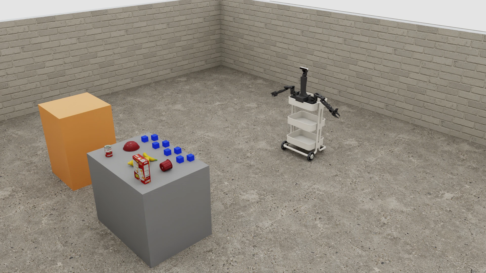
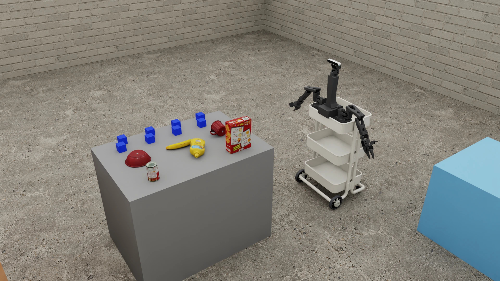
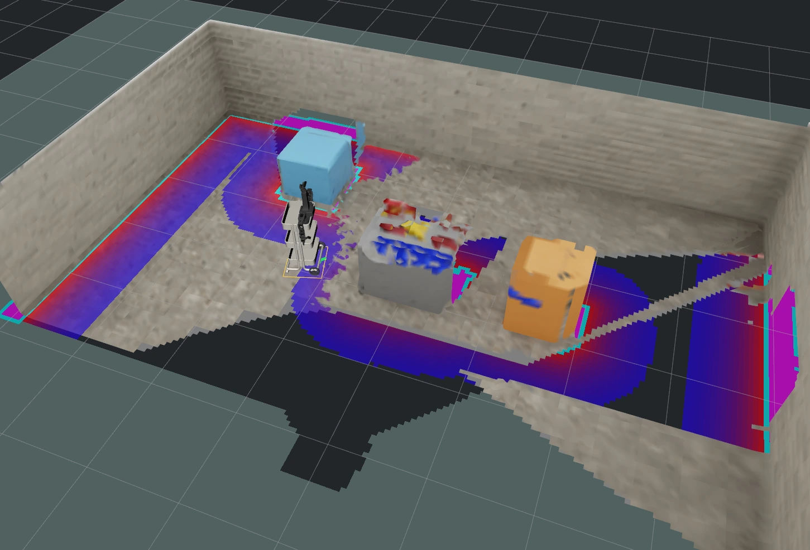
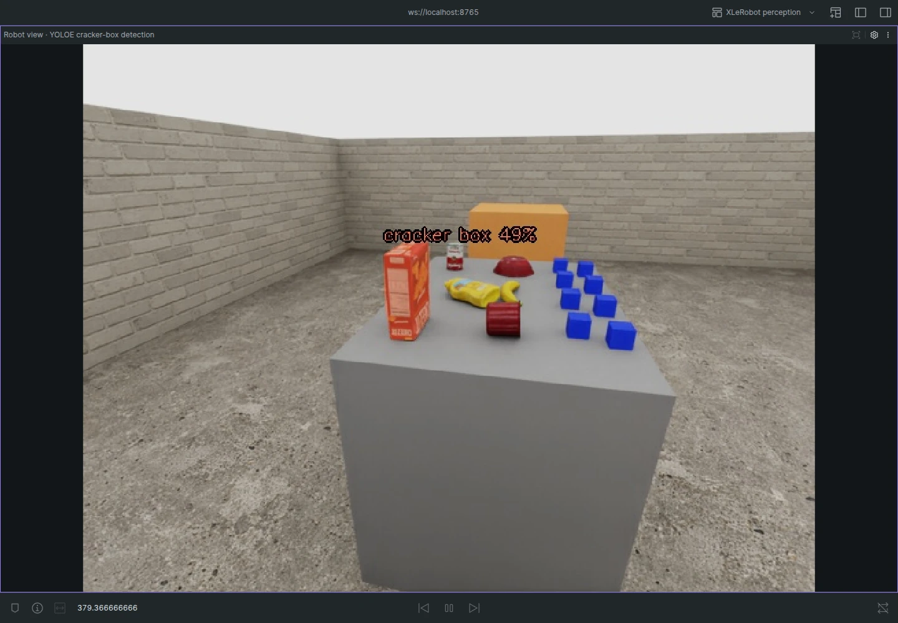

# Agentic XLeRobot

<table>
  <tr>
    <td width="50%" valign="top">
      <a href="docs/images/simulation-scene.webp"></a>
      <br><strong>Isaac Sim scene</strong><br>The robot and tabletop objects before navigation.
    </td>
    <td width="50%" valign="top">
      <a href="docs/images/object-approach.webp"></a>
      <br><strong>Object approach</strong><br>A successful supervised Nav2 approach to the cracker box.
    </td>
  </tr>
  <tr>
    <td width="50%" valign="top">
      <a href="docs/images/rviz-navigation.webp"></a>
      <br><strong>Navigation in RViz</strong><br>Live nvblox reconstruction, navigation costmap, and robot model.
    </td>
    <td width="50%" valign="top">
      <a href="docs/images/foxglove-cracker-detection.webp"></a>
      <br><strong>Robot view in Foxglove</strong><br>YOLOE detecting the cracker box through the simulated head camera.
    </td>
  </tr>
</table>

The Foxglove view uses the `cracker box` vocabulary and displays the live
`/xlerobot/yoloe/segmentation/image_raw/compressed` stream.
Click any image for its full-resolution view, or see the
[robot close-up](docs/images/robot-detail.webp) and
[full RViz window](docs/images/rviz-window.webp).

An undergraduate senior thesis exploring **which robot tools and feedback formats
best support a small local language model in carrying out natural-language
mobile-manipulation tasks**. The target is a physical two-wheel XLeRobot with
perception and language-model inference running together onboard Jetson AGX
Orin. Isaac Sim provides the current development and testing environment.

The intended demonstration is a task such as “find the cube and place it in the
marked area.” The model will choose detection vocabulary and sequence robot
tools. The research compares separate action tools with combined operations,
such as navigation plus grasping, while measuring reliability, latency, and
memory use.

**Status as of 2026-11-19:** the workstation prototype uses a hosted OpenAI model
and supports perception and supervised base navigation in simulation. Deploying
perception and a local LLM together on Orin, integrating the physical camera and
motors, and implementing tabletop manipulation remain planned work.

## Prerequisites

These requirements are for the current simulation prototype. The Jetson
deployment environment still needs to be integrated and validated.

- **Workstation:** Ubuntu 24.04, ROS 2 Jazzy, Python 3.12, and `colcon`. The
  environment script expects ROS at `/opt/ros/jazzy`.
- **Simulation:** Isaac Sim 6.2 and a compatible NVIDIA GPU/driver. Isaac defaults
  to `$HOME/isaacsim`; set `ISAAC_SIM_PATH` for another installation. Isaac is
  used for development and testing; physical operation will not require it.
- **ROS and perception dependencies:** follow the
  [workspace dependency setup](ros2_ws/README.md#dependencies). For navigation,
  also install the [Nav2, cuVSLAM, nvblox, YOLOE, and tabletop assets](ros2_ws/README.md#clicked-goal-navigation-with-live-nvblox-mapping)
  before building and launching the full scene.
- **Current hosted agent:** an `OPENAI_API_KEY` in your environment and an
  available model configured in the [agent](ros2_ws/src/xlerobot_agent/README.md#configuration).
  The target deployment will use local inference on Orin.

## Target deployment

| Location | Planned role |
| --- | --- |
| Onboard Jetson AGX Orin | YOLOE perception and local LLM inference running together, plus the agent, object memory, localization, mapping, navigation, and ROS control connected to the real camera and motor interfaces. |
| Optional remote computer or hosted provider | LLM inference only. Perception, ROS tool execution, and robot control remain onboard. |
| Development workstation | Isaac Sim for scene development, integration, and regression testing before physical trials. It is outside the physical robot's runtime. |

The physical robot will operate from real sensor feedback without an Isaac Sim
connection, simulated state, or simulator clock. LLM offloading is an optional
configuration for comparison or additional inference capacity; the primary goal
is onboard perception and local inference within the Orin's shared resource budget.

## What is built

| Area | Current implementation |
| --- | --- |
| Robot model and control | Detailed dual-wheel USD and matching URDF; shared `ros2_control` interfaces for the base, two arms, head, and grippers. Isaac and mock backends, wheel odometry, TF, diagnostics, keyboard driving, and command-timeout braking. |
| Simulation scene | Simulated D455 RGB/depth streams, a textured room, obstacles, a table, movable cubes, and textured YCB objects. |
| Localization and navigation | Image-based cuVSLAM localization, live nvblox depth mapping, and Nav2 route planning and obstacle avoidance. RViz clicked goals are available in normal navigation mode. |
| Perception | YOLOE text-prompted detection and segmentation, runtime vocabulary changes through a ROS service, and Foxglove visualization. |
| Object memory | Mask/depth projection into map coordinates, multi-observation confirmation, and SQLite storage of object UUIDs, last-known positions, observation history, and image crops. Records are scoped to map sessions and expose age/staleness. |
| Terminal agent | OpenAI tool calling, explicit plans, vocabulary selection, confirmed-object observation/query, conversation history, and JSONL execution traces. A scripted offline demo runs without API calls or a GPU. |
| Agent navigation | Opt-in tools for absolute map poses, relative destinations, and checked approach positions near confirmed objects. A ROS supervisor and velocity guard enforce readiness, session checks, timeouts, heartbeat expiry, cancellation, and measured-stop confirmation. |

The agent currently exposes `update_plan`, `set_perception_vocabulary`,
`observe_scene`, and `query_objects`. Enabling navigation adds
`get_navigation_state`, `navigate`, `navigate_relative`, `navigate_to_object`,
and `cancel_navigation`. See the [agent guide](ros2_ws/src/xlerobot_agent/README.md)
for arguments, behavior, and limits.

Stored observations can include stale objects and categories outside the active
detector vocabulary. An object query does not establish a fresh sighting, and
arrival near a stored location does not establish grasp readiness. Object
positions describe visible surfaces, not grasp poses. The navigation footprint
excludes articulated arms, and mapping assumes a static scene.

## Planned features and research work

1. **Onboard perception and local inference on Jetson AGX Orin.** Deploy YOLOE
   and a compact model with structured tool use on the same Orin. Integrate a
   local provider/runtime and validate the Jetson dependencies, combined memory
   use, perception update rate, and inference latency. Optional LLM offloading
   can provide a comparison while perception and robot execution stay onboard.
2. **Physical robot integration.** Connect the real camera and motor interfaces
   to the onboard ROS 2 stack. Run localization, mapping, navigation, and control
   from real sensor feedback and timestamps, without Isaac Sim in operation.
   Physical camera and motor backends are not yet implemented.
3. **Tabletop pick-and-place.** Build grasping, arm/gripper motion, and placement
   tools for a small set of graspable objects, and connect them to base approach
   positioning. Arm and gripper trajectory interfaces already exist; autonomous
   manipulation does not.
4. **Tool and feedback comparisons.** Compare individual action tools with
   combined operations using the same underlying robot capabilities and model
   configuration. Refine descriptions and feedback around object IDs,
   observation freshness, action outcomes, and failure reasons.
5. **Evaluation and thesis results.** Test explicit object names, indirect
   descriptions, multistep instructions, and follow-up requests under comparable
   starting conditions. Measure vocabulary/argument correctness, action order,
   navigation/grasp/placement success, planning latency, total task time,
   model-call count, perception update rate, and peak Jetson memory while
   perception and the LLM run concurrently. Use simulation for development and
   report physical trials separately, scoring them with fresh sensor observations,
   execution logs, and robot recordings. Separate model/interface errors from
   perception/motion failures and report any offloaded-LLM comparisons separately,
   including network latency. Hidden scene information will not be supplied to
   the model.

The work prioritizes a few complete, documented tasks over a broad task catalog.
Physical integration is required for the intended demonstration. The current
Isaac and mock backends support development; they do not yet provide a physical
robot runtime.

## Getting started

The current runnable setup is the simulation prototype. After installing the
prerequisites, build and launch it from the repository root:

```bash
cd ros2_ws
./scripts/build.sh
source scripts/env.sh
ros2 launch xlerobot_navigation sim_navigation.launch.py agent_navigation:=true
```

This starts Isaac Sim, perception, mapping, Nav2, and RViz with agent-controlled
navigation enabled.

Once the simulation is ready, open a second terminal at the repository root.
With `OPENAI_API_KEY` set and your model configured in the
[agent configuration](ros2_ws/src/xlerobot_agent/README.md#configuration), run:

```bash
cd ros2_ws
source scripts/env.sh
ros2 run xlerobot_agent agent --enable-navigation
```

Ask the agent something like **“Find the cracker box and move near it.”**
Use Ctrl+C in the agent terminal to cancel its current task.

Connect Foxglove to `ws://localhost:8765` for live camera and perception views.
See the [workspace guide](ros2_ws/README.md) for other launch options and the
[agent guide](ros2_ws/src/xlerobot_agent/README.md) for configuration and usage.

## Repository guide

- [ROS 2 workspace](ros2_ws/README.md): packages, dependencies, public interfaces,
  launch configuration, perception/mapping details, and integration tests.
- [Terminal agent](ros2_ws/src/xlerobot_agent/README.md): model configuration,
  tools, conversation behavior, traces, and supervised navigation.
- [Isaac model assets](xlerobot_isaac_sim/README.md): robot USD, source URDF,
  33 meshes, upstream license, and model validation.
