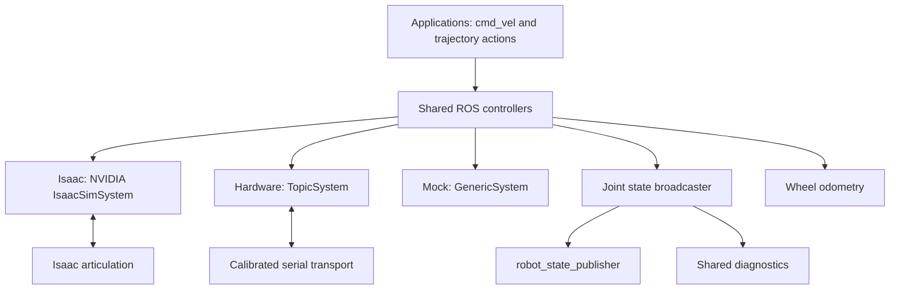

# XLeRobot DD ROS 2 workspace

One ROS interface for the two-wheel XLeRobot, with selectable Isaac Sim and
physical STS3215 transports. The same ros2_control controllers publish joint
states and odometry and serve trajectory actions in both modes. The same
robot_state_publisher owns the robot TF tree.

Environment: Ubuntu 24.04, ROS 2 Jazzy, Python 3.12, Fast DDS, and Isaac Sim
6.2.0 with NVIDIA’s bundled `isaacsim.ros2.control` 0.1.6. Isaac uses its bundled
ros2_control 4.47.0; hardware/mock use the workspace’s 4.48.1. The shared
ros2_controllers are 4.42.1. This runner requires Isaac 6.2.

## Build and select a backend

```bash
cd /home/justin/xlerobot-research/ros2_ws
./scripts/build.sh
source scripts/env.sh

ros2 launch xlerobot_bringup robot.launch.py backend:=isaac
# Or, without a GPU or physical motors:
ros2 launch xlerobot_bringup robot.launch.py backend:=mock
# Or, after configuring the physical robot:
ros2 launch xlerobot_bringup robot.launch.py backend:=hardware \
  hardware_config:=/absolute/path/to/hardware.yaml
```

Run one of these at a time. Backend selection happens at launch; switching means
stopping and relaunching the robot interface. Algorithm nodes use the same topic,
action, frame, and unit conventions. Their `use_sim_time` parameter must follow
the selected backend: `true` for Isaac, `false` for hardware or mock.

`headless:=true` runs Isaac without its GUI; `rviz:=true` opens the shared robot
model and TF display. Sensors and their publishing graph load by default;
`sensors:=false` excludes both the external D455 model and its graph.
`namespace:=xlerobot` is the default.
`start_sim:=false` starts the ROS nodes and spawners for an Isaac instance
already configured with this runner’s native controller graph, namespace, model,
and controller YAML. Opening the saved robot USD alone does not create that graph.

`scripts/env.sh` sources system Jazzy, workspace-local dependencies, and the
workspace overlay. It defaults to `ROS_DOMAIN_ID=42` and
`RMW_IMPLEMENTATION=rmw_fastrtps_cpp`, preserving existing values. Source it in
each terminal. Isaac defaults to `$HOME/isaacsim`; override `ISAAC_SIM_PATH` if
needed. `XLEROBOT_ASSET` defaults to the sibling
`xlerobot_isaac_sim/xlerobot_dd.usd`. Launch prints the resolved USD path.

Foxglove Bridge starts with every backend, under the robot namespace, and follows
the backend's `use_sim_time` setting. Connect Foxglove to `ws://localhost:8765`,
or `ws://<robot-ip>:8765` from another computer. The default bind address is
`0.0.0.0`; set `foxglove_address:=127.0.0.1` for local connections only. Use
`foxglove_port:=8766` to change the port, or `foxglove:=false` to disable the
bridge. Robot topics, global TF, and camera topics are available through it.

## Architecture and interfaces



Only the selected backend runs. Isaac hosts its controller manager inside the
simulator using NVIDIA’s `isaacsim.ros2.control.ROS2ControlManager` OmniGraph node
and `isaacsim_ros2_control/IsaacSimSystem` hardware plugin. The native plugin reads
joint feedback and applies controller commands directly during physics updates.
There is no external controller manager or command-topic transport in Isaac mode.
Hardware and mock retain their external ROS controller manager. All modes use
[`controllers.yaml`](src/xlerobot_control/config/controllers.yaml).

The controller managers load controller settings and topic remaps before spawning.
The spawner only loads, configures, and activates controllers; it avoids startup
parameter writes that can wait indefinitely after a lost DDS response. Wait for
the `Robot controllers ready` launch message before sending motion commands.

GUI launches open `/World/ROS2Control` in the Action Graph editor. It contains the
native controller manager and the clock publisher. The saved
`/World/xlerobot/Graphs/cmd_vel` graph is inactive in the composed stage so it
cannot compete with ros2_control for the wheel drives. The source USD retains
that graph. `/World/xlerobot/Graphs/realsense_ros2` remains active when sensors
are enabled. These changes live in the launch scene; launch never saves over the
robot USD.

Isaac derives its hardware interfaces from the USD drives: the wheels use
velocity control and the arms/head/grippers use position control. The shared
URDF remains the source for robot_state_publisher and hardware/mock interfaces.
The runner validates its link transforms and joint axes against the USD before
starting physics.

| Public interface, under `/xlerobot` | Type / meaning |
| --- | --- |
| `joint_states` | `sensor_msgs/msg/JointState`; 16 named joints, radians and rad/s |
| `left_arm_controller/follow_joint_trajectory` | `control_msgs/action/FollowJointTrajectory`; five left-arm joints |
| `right_arm_controller/follow_joint_trajectory` | Same action; five right-arm joints |
| `head_controller/follow_joint_trajectory` | Same action; pan and tilt |
| `gripper_controller/follow_joint_trajectory` | Same action; `Jaw_L` and `Jaw_R`, in radians |
| `cmd_vel` | `geometry_msgs/msg/TwistStamped`; forward m/s and yaw rad/s |
| `odom` | `nav_msgs/msg/Odometry`; wheel feedback, not simulation ground truth |
| `robot_description` | Shared URDF, transient-local topic |

Each trajectory must include all joints belonging to that controller. Joint
membership and common controller settings are in
[`controllers.yaml`](src/xlerobot_control/config/controllers.yaml).
For example, this head action works through either transport:

```bash
ros2 action send_goal /xlerobot/head_controller/follow_joint_trajectory \
  control_msgs/action/FollowJointTrajectory \
  "{trajectory: {joint_names: [head_pan_joint, head_tilt_joint], points: [{positions: [0.1, 0.0], time_from_start: {sec: 2}}]}}"
```

The original global `/cmd_vel` input accepts plain `geometry_msgs/msg/Twist`.
For keyboard driving with `teleop_twist_keyboard`, use the command and key bindings
in [`TELEOP.md`](../TELEOP.md).
Launch automatically stamps each received command using the selected backend's
clock and forwards it to `/xlerobot/cmd_vel`. With Isaac playing, use the original
command format; no timestamp or simulation-time flag is needed:

```bash
ros2 topic pub -r 10 /cmd_vel geometry_msgs/msg/Twist '{linear: {x: 0.05}}'
```

Ctrl+C stops publishing. The differential-drive controller stops after 0.5
seconds without a fresh command; the adapter never repeats old commands. The
direct `/xlerobot/cmd_vel` stamped input remains available for applications that
already use the backend's clock. Run one driving publisher at a time.
The shared `xlerobot_control/DiffDriveController` extends the upstream controller
to emit `Velocity command timed out. Braking.` once per timeout episode. It
continues braking throughout the timeout; fresh valid commands rearm the warning
for the next timeout. An initial idle timeout also produces only one warning.
The controller uses the model's 0.0635 m wheel radius and 0.45 m wheel separation.
The base velocity caps use XLeRobot's slow preset: 0.10 m/s and 30 degrees/s
(0.523599 rad/s). Initial acceleration limits remain deliberately low. These
settings can be changed in the shared controller configuration.

After sourcing `scripts/env.sh`, use `pub LINEAR ANGULAR` for manual commands
while Isaac is playing. The angular speed defaults to zero:

```bash
pub 0.05       # forward at 0.05 m/s
pub -0.05      # reverse
pub 0 0.15     # turn left at 0.15 rad/s
pub 0 -0.15    # turn right
pub 0          # publish zero velocity
```

Run one command at a time; Ctrl+C ends it and the controller's command timeout
stops the robot. The helper publishes `TwistStamped` at 10 Hz on
`/xlerobot/cmd_vel`, using fresh simulation timestamps. Use `--wall-time` for
hardware or mock, or `--namespace NAME` if launched with a different namespace.

Global interfaces are `/cmd_vel` (plain `Twist`), `/tf`, `/tf_static`,
`/diagnostics`, and, for Isaac only, `/clock`. Frame ownership is:

- `odom -> base_link`: differential-drive controller, using measured wheel motion.
- `base_link -> chassis -> robot links`: robot_state_publisher, using the shared URDF.
- `base_link` is the drive axle midpoint, facing the physical front (source chassis
  -X). The saved wheel joint names are opposite physical sides in this frame, so
  the differential-drive controller lists `right_wheel_joint` as its left wheel
  and `left_wheel_joint` as its right wheel. Authored joint axes are preserved.
  Fixed links use `/tf_static`; articulated links use `/tf`.

This workspace supports one robot per ROS domain. Topic namespaces do not prefix
TF frames. The basic robot launch provides odometry; the optional navigation
launch below adds the `map` frame and simulation localization.

Hardware transport topics are `backend/joint_states`, `backend/position_command`,
and `backend/velocity_command` under the robot namespace. Applications use the
public controllers above. Feedback contains all 16 joints with finite position
and velocity arrays. Position commands contain the 14 position joints; velocity
commands contain the two wheels.

Hardware TopicSystem waits for complete feedback, starts from measured joint
positions, limits commands, and faults after one second without valid feedback.
A fault requires explicit lifecycle recovery or relaunch. Hardware diagnostics
check raw transport feedback separately from the public broadcaster. Isaac
uses native plugin feedback through its joint-state broadcaster. Diagnostic
freshness uses wall time, including when simulation time stops.

## Clicked-goal navigation with live nvblox mapping

The simulation navigation launch combines the existing robot interface with
Nav2 and nvblox. It adds a small room with boxes, reconstructs obstacles from the
D455 depth camera, and accepts goals from RViz. No saved map is required.

Install the optional dependencies once, then build and launch from `ros2_ws/`:

```bash
python3 scripts/install_local_dependencies.py --navigation
./scripts/build.sh
source scripts/env.sh
ros2 launch xlerobot_navigation sim_navigation.launch.py
```

For later sessions, only source `scripts/env.sh` and run the launch command;
the dependencies, configuration, and built packages remain in the workspace.
This launch includes the robot and Isaac, so stop any previous robot or
navigation launch before starting it. Use Ctrl+C in the launch terminal to stop
the session.

The installer extracts signed repository packages into `.deps/root` and keeps
repository configuration under `.deps/apt`; it does not install system packages
or change the graphics driver. This x86 Ubuntu 24.04/Jazzy setup pins NVIDIA's
Isaac ROS 4.3 repository and uses CUDA 13.0 libraries with the host's 580-series
driver. NVIDIA's package dependencies also pull the CUDA toolkit; allow several
GB for downloads and additional space for extraction. This installer is for the
simulation workstation, not a Jetson deployment recipe.

Wait for `Live depth map ready; activating Nav2` and for the Navigation 2 panel
to show navigation as active. Choose **Nav2 Goal**, then click and drag in mapped
free space to set the destination and final heading. The robot initially faces
world -X; a first goal near `(x=-1.1, y=0)` with the arrow pointing toward -X is
in front of it. The colored mesh shows reconstruction, the costmap shows
obstacle clearance, and the green line shows the planned path. Unknown space
remains unknown and the planner rejects routes through it.

The panel's **Localization: inactive** indicator is expected: it monitors
Nav2's managed localization stack, while this simulation uses Isaac's measured
pose. No **2D Pose Estimate** or saved occupancy map is needed.

Use the Navigation 2 panel's **Cancel** button to stop a goal. Cancel navigation
before using manual `pub` or `/cmd_vel` commands to look around and expand the
observed map. Run one driving source at a time. Goals use
`/xlerobot/navigate_to_pose` (`nav2_msgs/action/NavigateToPose`).

Use `headless:=true` to hide Isaac's window and `rviz:=false` to disable RViz.
`namespace` and `foxglove` work as in the basic robot launch. All navigation
nodes use simulation time. The planner is Smac 2D and the path follower is
Regulated Pure Pursuit; the navigation guard limits autonomous commands to
0.10 m/s and 0.20 rad/s.
Configuration is in [`xlerobot_navigation/config/`](src/xlerobot_navigation/config/).

Isaac publishes the measured axle pose on `sim_ground_truth`. A simulation-only
localization node derives `map -> odom` from that measurement and same-time wheel
odometry. The drive controller still owns `odom -> base_link`, and the shared
robot description owns the camera's articulated mount. `map` is aligned with the
Isaac world, with its floor at Z=0. nvblox integrates timestamped camera poses
and projects obstacles between 0.08 m and 1.4 m into the navigation costmaps.
Both costmaps use `map`; the local one rolls with the robot. This avoids passing
the axle-to-floor height offset through nvblox's planar costmap transform.

Autonomous velocities pass through a guard that stops on stale depth, map, pose,
or command data, including a paused simulation clock. Mapping starts afresh with
each launch, assumes a static scene, and clears reconstruction beyond 8 m of the
robot. This milestone uses a fixed driving posture and simulated localization;
physical localization, map persistence, and dynamic-object reconstruction are
separate work.

Run the isolated GPU acceptance test without opening physical motor ports:

```bash
source scripts/env.sh
python3 scripts/test_navigation.py
```

It uses domain 96, namespace `xlerobot_test`, and a headless simulation. It checks
reconstruction, a planned drive to a visible goal, rejection of a goal inside a
box, and cancellation. Launch output is in `log/navigation-test.log`. Add
`--gui` to show Isaac, `--rviz` to show the goal interface, or `--domain-id N`
to choose another unused domain.

Validated on 2026-10-20 with the RTX 5080 host: live nvblox reconstruction,
0.83 m of actual simulated body travel with 0.119 m endpoint error, rejection
of a goal inside the center box, and cancellation all passed. The RViz run
loaded the robot, map, path, mesh, and Nav2 panel without plugin-load errors.

## Physical robot configuration

Copy [`hardware.example.yaml`](src/xlerobot_hardware/config/hardware.example.yaml)
outside the source template and fill every `null`. The template's IDs come from
the [upstream two-wheel XLeRobot definition](https://github.com/Vector-Wangel/XLeRobot/blob/main/software/src/robots/xlerobot_2wheels/xlerobot_2wheels.py).
No mapping or calibration from `toro/xlerobot-pro` is used.

The adapter supports STS3215 servos over serial buses. Configuration supplies:

- Serial paths and baud rates; stable `/dev/serial/by-id/...` paths are preferable.
- The bus and motor ID for every URDF joint.
- `zero_tick`: the reported encoder position at that joint's URDF zero angle,
  after the servo's existing homing offset.
- `direction`: +1 or -1 relating encoder motion to positive URDF rotation.
- `min_tick`, `max_tick`: calibrated encoder bounds, intersected with URDF limits.
- `max_velocity`: rad/s; position motor speed limits and wheel command limits.

Calibration uses `q = direction * (ticks - zero_tick) * 2π/4096`. Wheel position
is unwrapped relative to startup. LeRobot percentages or degree-based calibration
cannot be inserted as radians. A position command outside the calibrated/URDF
intersection faults the transport. Wheel speed is bounded to its configured limit.
The current adapter assumes direct-drive, single-turn position servos; different
actuator types or gearing need a matching transport implementation.

Before activation, the adapter checks all servo model numbers and operating modes
and reads complete feedback. Position joints must already be in mode 0 and wheels
in mode 1. It seeds hold targets before enabling torque, and requires both controller
command streams. It does not write EEPROM, IDs, modes, homing offsets, or PID gains.
A 0.5-second wall-clock command watchdog defaults to stopping the transport.
On shutdown or a detected fault it attempts to stop wheels and hold the last
measured position of the arms/head/grippers, leaving their torque enabled.
A severed serial link or killed host cannot deliver a software stop; use the
robot's physical stop/power controls for that failure case.

**Real motors have not been exercised.** The physical path was tested through the
actual SDK and ROS nodes using two pseudo-terminal servo buses. Actual ports,
zero offsets, directions, travel limits, bus timing, and physical motion still
need validation on your robot. The incomplete template fails before opening ports.

## Packages and model ownership

| Package | Responsibility |
| --- | --- |
| `xlerobot_description` | Generated URDF, model joint limits, portable mesh references |
| `xlerobot_control` | C++ TopicSystem hardware plugin, differential-drive timeout logging, and shared controller configuration |
| `xlerobot_isaac` | Isaac scene composition, native controller manager, sensors, clock |
| `xlerobot_hardware` | Calibration validation, serial SDK adapter, command watchdog |
| `xlerobot_diagnostics` | Shared interface monitor and passive check |
| `xlerobot_bringup` | Backend selection, controller startup, TF, diagnostics, optional RViz |
| `xlerobot_navigation` | Nav2, nvblox, simulated localization, clicked goals, and navigation command guard |

The selected model is `../xlerobot_isaac_sim/xlerobot_dd.usd`: the recovered
XLeRobot with detailed 5-inch tires, printed hubs, rear-only caster meshes,
wheel contact materials, and its saved RealSense mount. The matching URDF and
33 meshes are stored under `../xlerobot_isaac_sim/source/`; this workspace has
no runtime dependency on the original project.

Regenerate the shared ROS description after editing the DD source URDF:

```bash
python3 src/xlerobot_description/scripts/generate_description.py
./scripts/build.sh
```

The description generator preserves geometry, joint axes, and limits, replaces
the world anchor with a mobile axle frame, and supplies conservative defaults
where source limits are missing. The configuration records the source URDF
SHA-256. Updating source kinematics also requires updating the matching USD;
startup rejects USD/URDF disagreement.

Isaac references the DD asset into an in-memory stage and verifies all shared
link transforms, all 16 joint axes, and visible tire/core/hub meshes. It adds
arm/head position servos for ros2_control. The camera graph runs when sensors are
enabled; execution inputs of its redundant clock and robot-TF nodes are
disconnected. Camera-specific TF and stream publishers remain connected.

The launch wrapper puts Isaac’s bundled CUDA and native ROS libraries on the
loader path before Python starts. This avoids the older system CUDA runtime and
missing ROS plugin dependencies. A version-gated correction in
[`native_compat.py`](src/xlerobot_isaac/xlerobot_isaac/native_compat.py) preserves
fixed ancestors when ros2.control 0.1.6 exports its controller URDF; without it,
the arm/head branches become disconnected roots. It does not replace NVIDIA’s
hardware plugin or control loop and does not modify installed NVIDIA files.

The default `sensors:=true` selects the saved D455 model and mount through the DD
asset’s `Sensor` variant and activates `realsense_ros2`. It publishes RGB and
camera info under `/camera/color/`, depth, camera info, and points under
`/camera/depth/`, and the camera mount/optical TF chain. Set `sensors:=false` to
select `None` and disable both the external sensor and this graph for offline
startup. The vendor D455 is an external NVIDIA
asset. Existing camera-link mass/inertia warnings still require dynamics work.

## Validation

The acceptance test checks 16 joints, six controllers, TF, odometry, diagnostics,
head trajectories, sustained wheel motion, and command timeout through both
public velocity inputs. In Isaac mode it also checks that NVIDIA’s native
IsaacSimSystem owns the joints and that no legacy command relay is publishing.
The motion test requires more than 2 radians of travel per wheel over five
seconds to verify sustained movement.
USD/URDF frame and axis parity, visible wheel meshes, contact dimensions, and
preserved wheel-drive limits have separate offline checks.

Current status (2026-10-20): manual `cmd_vel` commands now move the robot in
Isaac Sim, confirmed by the user. The Isaac `--check-motion` acceptance test has
not been rerun for this documentation update; sustained travel over the test
duration and command-timeout behavior still need automated revalidation.

Previously recorded automated results: the Isaac interface/graph and
head-trajectory checks passed. The mock and emulated-hardware backends passed
sustained motion and command-timeout checks; emulated serial-disconnect handling
also passed.

```bash
source scripts/env.sh
colcon test --event-handlers console_direct+
colcon test-result --verbose
python3 scripts/test_sim.py --backend mock --check-motion
python3 scripts/test_sim.py --backend emulated --check-motion --check-disconnect
python3 scripts/test_sim.py --backend isaac --check-motion
python3 scripts/test_sim.py --backend isaac --sensors true
```

Integration tests never open physical motor ports. They use domain 91 by default,
namespace `xlerobot_test`, disable sensors by default (`--sensors true` enables them), and write
`log/<backend>-test.log`. They disable Foxglove Bridge to avoid competing with an
existing robot session for its WebSocket port. Select an unused
domain with `--domain-id`. DDS unit tests use domains 92 and 94. Checks require
local networking; the Isaac test also requires GPU access. The sensor-enabled
test verifies camera messages, frame IDs, mount/optical transforms, and a single
clock publisher. Add `--gui` to show the native controller Action Graph editor.
RViz has not been tested.

For a passive check of an already running interface:

```bash
ros2 run xlerobot_diagnostics check_bridge --timeout 120 \
  --ros-args -r __ns:=/xlerobot -p require_backend_feedback:=false
# Hardware: use -p require_clock:=false -p require_backend_feedback:=true
# Mock: add -p require_clock:=false
ros2 topic echo /diagnostics
```

## Dependencies

The required ROS controller packages and Python servo SDK have been installed
locally under this workspace's ignored `.deps/` directory. `env.sh` includes them;
the operating system installation was not changed.

On another Jazzy machine, prefer system ROS dependencies:

```bash
sudo apt install python3-colcon-common-extensions python3-rosdep
rosdep update
rosdep install --from-paths src --ignore-src --rosdistro jazzy -y
python3 -m pip install --target .deps/python -r requirements-hardware.txt
```

If administrative package installation is unavailable, the local dependency
helper uses the host's configured apt repositories and extracts dependencies
without running package maintainer scripts:

```bash
python3 scripts/install_local_dependencies.py
python3 -m pip install --target .deps/python -r requirements-hardware.txt
./scripts/build.sh
```

This fallback is specific to the Ubuntu 24.04/Jazzy layout. Isaac Sim and GPU
drivers are separate dependencies. Keep native Jazzy and Isaac 6.x libraries
compatible. Package licensing and maintainer metadata remain project placeholders.
