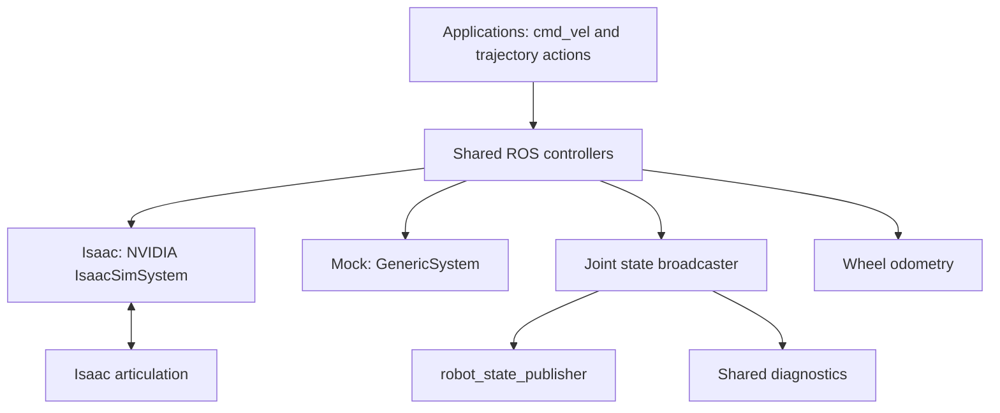

# XLeRobot DD ROS 2 workspace

One ROS interface for the two-wheel XLeRobot, with Isaac Sim and a mock backend
for interface tests. The same ros2_control controllers publish joint
states and odometry and serve trajectory actions in both modes. The same
robot_state_publisher owns the robot TF tree.

Physical motor transport is deferred until real-robot integration. No serial
driver or physical backend is included in this workspace.

Environment: Ubuntu 24.04, ROS 2 Jazzy, Python 3.12, Fast DDS, and Isaac Sim
6.2.0 with NVIDIA’s bundled `isaacsim.ros2.control` 0.1.6. Isaac uses its bundled
ros2_control 4.47.0; mock uses the workspace’s 4.48.1. The shared
ros2_controllers are 4.42.1. This runner requires Isaac 6.2.

## Build and select a backend

```bash
cd /home/justin/xlerobot-research/ros2_ws
./scripts/build.sh
source scripts/env.sh

ros2 launch xlerobot_bringup robot.launch.py backend:=isaac
# Or, without a GPU or physical motors:
ros2 launch xlerobot_bringup robot.launch.py backend:=mock
```

Run one of these at a time. Backend selection happens at launch; switching means
stopping and relaunching the robot interface. Algorithm nodes use the same topic,
action, frame, and unit conventions. Their `use_sim_time` parameter must follow
the selected backend: `true` for Isaac, `false` for mock.

`headless:=true` runs Isaac without its GUI; `rviz:=true` opens the shared robot
model and TF display. Sensors and their publishing graph load by default;
`sensors:=false` excludes both the external D455 model and its graph.
`namespace:=xlerobot` is the default.
`start_sim:=false` starts the ROS nodes and spawners for an Isaac instance
already configured with this runner’s native controller graph, namespace, model,
and controller YAML. Opening the saved robot USD alone does not create that graph.

`scripts/env.sh` sources system Jazzy, workspace-local dependencies, and the
workspace overlay. It defaults to `ROS_DOMAIN_ID=42` and
`RMW_IMPLEMENTATION=rmw_fastrtps_cpp`, preserving existing values. Source it in
each terminal. Isaac defaults to `$HOME/isaacsim`; override `ISAAC_SIM_PATH` if
needed. `XLEROBOT_ASSET` defaults to the sibling
`xlerobot_isaac_sim/xlerobot_dd.usd`. Launch prints the resolved USD path.

Foxglove Bridge starts with every backend, under the robot namespace, and follows
the backend's `use_sim_time` setting. Connect Foxglove to `ws://localhost:8765`,
or `ws://<robot-ip>:8765` from another computer. The default bind address is
`0.0.0.0`; set `foxglove_address:=127.0.0.1` for local connections only. Use
`foxglove_port:=8766` to change the port, or `foxglove:=false` to disable the
bridge. Robot topics, global TF, and camera topics are available through it.

## Architecture and interfaces



Only the selected backend runs. Isaac hosts its controller manager inside the
simulator using NVIDIA’s `isaacsim.ros2.control.ROS2ControlManager` OmniGraph node
and `isaacsim_ros2_control/IsaacSimSystem` hardware plugin. The native plugin reads
joint feedback and applies controller commands directly during physics updates.
There is no external controller manager or command-topic transport in Isaac mode.
Mock uses an external ROS controller manager. Both modes use
[`controllers.yaml`](src/xlerobot_control/config/controllers.yaml).

The controller managers load controller settings and topic remaps before spawning.
The spawner only loads, configures, and activates controllers; it avoids startup
parameter writes that can wait indefinitely after a lost DDS response. Wait for
the `Robot controllers ready` launch message before sending motion commands.

Isaac overrides `base_controller.position_feedback` to `false` in a temporary
copy of the controller configuration. Its raw continuous wheel positions wrap
by approximately 4π; position differencing otherwise produces false odometry
jumps (observed: 0.35 m and 1.77 rad in one update). The simulator now integrates
measured wheel velocities with `open_loop: false`. Mock retains the
shared position-feedback configuration.

The launch scene enables PhysX `enableExternalForcesEveryIteration` and uses
zero TGS velocity iterations on the robot articulation, retaining its position
iterations. NVIDIA
documents a [TGS articulation-drive limitation](https://docs.omniverse.nvidia.com/kit/docs/omni_physics/latest/dev_guide/guides/current_limitations.html)
where stationary joints report nonzero velocities without this setting. On this
robot, a stalled run reported wheel velocities of 0.133 and 0.242 rad/s while
encoder changes were approximately -0.003 rad/s. That biased wheel odometry and
trapped Nav2's turn acceleration limiter near zero command. Applying external
forces each solver iteration reduced the error, but the large-turn regression
still found a velocity bias with the default one velocity iteration. Using zero
velocity iterations as well corrected the feedback in the regression;
odometry still uses measured wheel velocities, with no simulator ground truth
fed into cuVSLAM navigation. This setting requires restarting Isaac.

GUI launches open `/World/ROS2Control` in the Action Graph editor. It contains the
native controller manager and the clock publisher. The saved
`/World/xlerobot/Graphs/cmd_vel` graph is inactive in the composed stage so it
cannot compete with ros2_control for the wheel drives. The source USD retains
that graph. `/World/xlerobot/Graphs/realsense_ros2` remains active when sensors
are enabled. These changes live in the launch scene; launch never saves over the
robot USD.

Isaac derives its hardware interfaces from the USD drives: the wheels use
velocity control and the arms/head/grippers use position control. The shared
URDF remains the source for robot_state_publisher and mock interfaces.
The runner validates its link transforms and joint axes against the USD before
starting physics.

| Public interface, under `/xlerobot` | Type / meaning |
| --- | --- |
| `joint_states` | `sensor_msgs/msg/JointState`; 16 named joints, radians and rad/s |
| `left_arm_controller/follow_joint_trajectory` | `control_msgs/action/FollowJointTrajectory`; five left-arm joints |
| `right_arm_controller/follow_joint_trajectory` | Same action; five right-arm joints |
| `head_controller/follow_joint_trajectory` | Same action; pan and tilt |
| `gripper_controller/follow_joint_trajectory` | Same action; `Jaw_L` and `Jaw_R`, in radians |
| `cmd_vel` | `geometry_msgs/msg/TwistStamped`; forward m/s and yaw rad/s |
| `odom` | `nav_msgs/msg/Odometry`; wheel feedback, not simulation ground truth |
| `robot_description` | Shared URDF, transient-local topic |

Each trajectory must include all joints belonging to that controller. Joint
membership and common controller settings are in
[`controllers.yaml`](src/xlerobot_control/config/controllers.yaml).
For example, this head action works with either backend:

```bash
ros2 action send_goal /xlerobot/head_controller/follow_joint_trajectory \
  control_msgs/action/FollowJointTrajectory \
  "{trajectory: {joint_names: [head_pan_joint, head_tilt_joint], points: [{positions: [0.1, 0.0], time_from_start: {sec: 2}}]}}"
```

The original global `/cmd_vel` input accepts plain `geometry_msgs/msg/Twist`.
For keyboard driving with `teleop_twist_keyboard`, use the command and key bindings
in [`TELEOP.md`](../TELEOP.md).
Launch automatically stamps each received command using the selected backend's
clock and forwards it to `/xlerobot/cmd_vel`. With Isaac playing, use the original
command format; no timestamp or simulation-time flag is needed:

```bash
ros2 topic pub -r 10 /cmd_vel geometry_msgs/msg/Twist '{linear: {x: 0.05}}'
```

Ctrl+C stops publishing. The differential-drive controller stops after 0.5
seconds without a fresh command; the adapter never repeats old commands. The
direct `/xlerobot/cmd_vel` stamped input remains available for applications that
already use the backend's clock. Run one driving publisher at a time.
The shared `xlerobot_control/DiffDriveController` extends the upstream controller
to emit `Velocity command timed out. Braking.` once per timeout episode. It
continues braking throughout the timeout; fresh valid commands rearm the warning
for the next timeout. An initial idle timeout also produces only one warning.
The controller uses the model's 0.0635 m wheel radius and 0.45 m wheel separation.
The base velocity caps use XLeRobot's slow preset: 0.10 m/s and 30 degrees/s
(0.523599 rad/s). Initial acceleration limits remain deliberately low. These
settings can be changed in the shared controller configuration.

After sourcing `scripts/env.sh`, use `pub LINEAR ANGULAR` for manual commands
while Isaac is playing. The angular speed defaults to zero:

```bash
pub 0.05       # forward at 0.05 m/s
pub -0.05      # reverse
pub 0 0.15     # turn left at 0.15 rad/s
pub 0 -0.15    # turn right
pub 0          # publish zero velocity
```

Run one command at a time; Ctrl+C ends it and the controller's command timeout
stops the robot. The helper publishes `TwistStamped` at 10 Hz on
`/xlerobot/cmd_vel`, using fresh simulation timestamps. Use `--wall-time` for
mock, or `--namespace NAME` if launched with a different namespace.

Global interfaces are `/cmd_vel` (plain `Twist`), `/tf`, `/tf_static`,
`/diagnostics`, and, for Isaac only, `/clock`. Frame ownership is:

- `odom -> base_link`: differential-drive controller, using measured wheel motion.
- `base_link -> chassis -> robot links`: robot_state_publisher, using the shared URDF.
- `base_link` is the drive axle midpoint, facing the physical front (source chassis
  -X). The saved wheel joint names are opposite physical sides in this frame, so
  the differential-drive controller lists `right_wheel_joint` as its left wheel
  and `left_wheel_joint` as its right wheel. Authored joint axes are preserved.
  Fixed links use `/tf_static`; articulated links use `/tf`.

This workspace supports one robot per ROS domain. Topic namespaces do not prefix
TF frames. The basic robot launch provides odometry; the optional navigation
launch below adds the `map` frame and cuVSLAM localization.

Isaac exposes native plugin feedback through its joint-state broadcaster.
Diagnostics monitor the public joint states, TF, and advancing simulation clock.
Diagnostic freshness uses wall time, including when simulation time stops.

## Clicked-goal navigation with live nvblox mapping

The simulation navigation launch combines the existing robot interface with
Nav2, nvblox, and Isaac ROS cuVSLAM in RGBD mode. It adds a small room with boxes,
estimates motion from the D455 images, reconstructs obstacles from depth, and
accepts goals from RViz. No saved map is required.

The room uses matte painted-brick walls and a worn-concrete floor, with locally
packaged albedo textures in `src/xlerobot_isaac/textures/`. Their generation
prompts and provenance are in `textures/prompts.json`. Textures use physical
scale and different offsets on opposing walls; existing colliders and friction
are unchanged. Visual detail matters: cuVSLAM must track features across images,
even in RGBD mode. Blank surfaces can drift while tracking status still reports
success. A controlled rotation-and-forward comparison measured 0.325 m peak
visual position error with blank surfaces versus 0.015 m with these textures,
using the same velocity-feedback configuration and independent simulator poses.
These are short simulation measurements, not a general accuracy guarantee.

Install the optional dependencies, then build and launch from `ros2_ws/`:

```bash
python3 scripts/install_local_dependencies.py --navigation
bash scripts/install_yoloe.sh
./scripts/build.sh
source scripts/env.sh
ros2 launch xlerobot_navigation sim_navigation.launch.py
```

For later sessions, only source `scripts/env.sh` and run the launch command;
the dependencies, configuration, and built packages remain in the workspace.
This launch includes the robot and Isaac, so stop any previous robot or
navigation launch before starting it. Use Ctrl+C in the launch terminal to stop
the session.

The installer extracts signed repository packages into `.deps/root` and keeps
repository configuration under `.deps/apt`; it does not install system packages
or change the graphics driver. This x86 Ubuntu 24.04/Jazzy setup pins NVIDIA's
Isaac ROS 4.3 repository and uses CUDA 13.0 libraries with the host's 580-series
driver. NVIDIA's package dependencies also pull the CUDA toolkit; allow several
GB for downloads and additional space for extraction. This installer is for the
simulation workstation, not a Jetson deployment recipe.

Wait for `Live depth map ready; activating Nav2` and for the Navigation 2 panel
to show navigation as active. Choose **Nav2 Goal**, then click and drag in mapped
free space to set the destination and final heading. With cuVSLAM, the map starts
at the robot's initial base position, facing map +X. A first goal near
`(x=0.8, y=0)` with the arrow pointing toward +X is in front of it.
The colored mesh shows reconstruction, the costmap shows
obstacle clearance, and the green line shows the planned path. Unknown space
remains unknown and the planner rejects routes through it.

The panel's **Localization: inactive** indicator is expected: it monitors
Nav2's managed localization stack, while our pose comes from cuVSLAM.
No **2D Pose Estimate** or saved occupancy map is needed.

Use the Navigation 2 panel's **Cancel** button to stop a goal. Cancel navigation
before using manual `pub` or `/cmd_vel` commands to look around and expand the
observed map. Run one driving source at a time. Goals use
`/xlerobot/navigate_to_pose` (`nav2_msgs/action/NavigateToPose`).

Use `headless:=true` to hide Isaac's window and `rviz:=false` to disable RViz.
`namespace` and `foxglove` work as in the basic robot launch. All navigation
nodes use simulation time. The planner is Smac 2D and the path follower is
Regulated Pure Pursuit; the navigation guard limits autonomous commands to
0.10 m/s and 0.20 rad/s.
`PoseProgressChecker` recognizes either 0.08 m of translation or 0.15 rad of
rotation within 30 seconds. This lets the robot align with the path or final
heading without triggering a translation-only progress timeout. The normal
turn speed remains 0.15 rad/s. RPP's angular acceleration setting is 1.0 rad/s²,
allowing an initial turn request of 0.05 rad/s at 20 Hz from zero measured speed.
The base controller retains its separate 0.4 rad/s² command acceleration limit.
Configuration is in [`xlerobot_navigation/config/`](src/xlerobot_navigation/config/).

Both costmaps use a cart-and-wheels footprint, excluding the articulated arms.
Its rectangle is measured in `base_link` from the shared URDF collision shapes
and visual meshes, including the rear caster proxies and outer wheel hubs.
The rear caster collision bound is X = -0.355933 m, the tire front is
X = +0.0635 m, and the outer hubs reach approximately Y = ±0.2518 m.
Rounding outward to 1 mm gives X = [-0.356, +0.064] m and
Y = [-0.252, +0.252] m. `footprint_padding: 0.02` adds 2 cm on each side,
making the checked rectangle 0.460 m long and 0.544 m wide. Its boundaries
relative to the axle are 0.084 m forward, 0.376 m rearward, and 0.272 m
left/right. RViz shows this padded outline as **Cart footprint (with padding)**.
The 0.8 m inflation radius and goal tolerances are separate settings.

Localization always uses NVIDIA's cuVSLAM estimator with one RGB image,
pixel-aligned depth, and color camera calibration. Isaac renders the aligned
depth from the color optical center; `cuvslam_depth_conversion` converts float
meters to uint16 millimeters without changing acquisition timestamps. The
original D455 depth stream still supplies nvblox.

The launch overrides the saved camera asset's 6 Hz sensor rate to 30 Hz
(33.3 ms between exposures in simulation time). RGBD tracking uses reliable
image delivery so dropped UDP fragments do not discard whole RGB/depth pairs.
The 50 ms cuVSLAM frame-interval threshold remains enabled. A repeated
`Delta between current and previous frame ... above threshold [50 ms]` warning
means tracking is missing frames; it is not a 50 ms processing-time measurement.
After updating from the earlier 6 Hz setup, stop and relaunch navigation to
apply the camera settings and discard the old reconstruction.

cuVSLAM tracks `head_camera_link`, to which the camera is rigidly attached.
`vslam_localization` uses same-time joint transforms to remove head motion and
derive the base pose, then publishes `map -> odom`. It does not estimate motion
or subscribe to `sim_ground_truth`. cuVSLAM's own TF publishers are disabled;
the drive controller owns `odom -> base_link`, and the shared description owns
the articulated camera mount. `/xlerobot/localization/pose` reports the resulting
base pose, and `/xlerobot/visual_slam/status` reports tracking success/loss.

The initial base pose defines map X/Y/yaw. Initialization assumes a level base
with the axle 0.0635 m above the floor; subsequent estimates retain full 3D
motion. This gives nvblox a floor-level map without reading simulator poses.
nvblox integrates timestamped camera poses
and projects obstacles between 0.08 m and 1.4 m into the navigation costmaps.
Both costmaps use `map`; the local one rolls with the robot. This avoids passing
the axle-to-floor height offset through nvblox's planar costmap transform.

Autonomous velocities pass through a guard that stops on visual tracking loss
or stale depth, map, estimated pose, tracking status, or commands, including a
paused simulation clock. Mapping starts afresh with
each launch, assumes a static scene, and clears reconstruction beyond 8 m of the
robot. cuVSLAM requires visible image features and can lose tracking in blank
scenes. It can correct poses on loop closure; the current nvblox map does not
reintegrate old observations after those corrections. Map persistence,
dynamic-object reconstruction, and physical-camera bringup are separate work.

Simulator ground truth remains published on `/xlerobot/sim_ground_truth` for
independent test measurements. Navigation uses only cuVSLAM estimates.
The ground-truth message frame is `sim_world`, distinct from cuVSLAM's map.

Configuration follows NVIDIA's [Isaac ROS 4.3 RGBD example](https://nvidia-isaac-ros.github.io/v/release-4.3/concepts/visual_slam/cuvslam/tutorial_realsense_rgbd.html).

Run the isolated GPU acceptance test without opening physical motor ports:

```bash
source scripts/env.sh
python3 scripts/test_navigation.py
```

It uses domain 96, namespace `xlerobot_test`, and a headless simulation. It checks
reconstruction, a planned drive to a visible goal, localization error against
independent simulator measurements, rejection of a goal inside a box, turns
in both directions, and cancellation. One turn uses 0.06 rad/s in the isolated
test and lasts over 30 seconds to verify angular progress, then restores the
normal 0.15 rad/s setting. A return goal checks timely forward travel after
initial path alignment. The test compares reported wheel velocities with
wrapped encoder displacement at rest and during turns, and rejects stationary
odometry bias. It then performs a measured full 360-degree turn,
checks timestamp-aligned visual pose errors throughout the turn, and rejects
wheel-odometry discontinuities as the raw wheel angles wrap. It also verifies
that only the test observer subscribes to simulator ground truth.
Before driving it checks stationary drift and visual frame intervals for 15
simulation seconds. Use `--idle-seconds 90` for the longer drift regression.
Launch output is in `log/navigation-test.log`. Add
`--gui` to show Isaac, `--rviz` to show the goal interface, or `--domain-id N`
to choose another unused domain.

cuVSLAM validated on 2026-10-20 with textures and velocity feedback on the RTX
5080 host: 0.788 m of measured travel, 0.173 m goal error, 0.016 m visual
localization error, rejection of an occupied goal, a 0.5 rad turn with 0.127 rad
final heading error, and cancellation passed. The full 360-degree regression
passed with maximum visual error 0.023 m and 0.003 rad, and continuous wheel
odometry across four raw wheel-angle wraps. Ten navigation/Isaac unit tests passed.
These are short simulation acceptance checks; physical-camera performance and long-route drift are not yet
validated.

## YOLOE segmentation in Foxglove

Navigation bringup starts YOLOE and its separate image renderer by default.
Add `yoloe:=false` to disable both, or `yoloe_visualize:=false` to keep detections
and semantic masks without rendering the overlay. The pipeline subscribes to
`/camera/color/image_raw`; it does not depend on Isaac or a particular camera
driver. Set `yoloe_image_topic:=/image_raw` if that is the physical camera's topic.

The default is the small text-prompted `yoloe-11s-seg.pt` checkpoint, initially
looking for **red, orange, yellow, green, blue, purple, black, and white cubes**.
It merges YOLOE's object masks into a class label map;
undetected pixels remain unknown. This is object segmentation, not exhaustive
labeling of floor, walls, and background. See the
[YOLOE model documentation](https://docs.ultralytics.com/models/yoloe/).

One-time setup on this workstation (already installed during implementation):

```bash
bash scripts/install_yoloe.sh
./scripts/build.sh --packages-select xlerobot_perception_interfaces xlerobot_perception xlerobot_navigation
source scripts/env.sh
```

The installer keeps PyTorch 2.9.1/CUDA 12.8, torchvision 0.24.1, and Ultralytics
8.4.184 and a pinned CLIP tokenizer in `.deps/yoloe`. It downloads the detector
and `mobileclip_blt.ts` text encoder to `.deps/models`.
It leaves the system ROS and Isaac Python environments alone. Runtime uses local
weights; a missing model produces a setup error. `XLEROBOT_YOLOE_PYTHON`,
`XLEROBOT_YOLOE_MODEL`, and `XLEROBOT_YOLOE_TEXT_ENCODER` can override the paths
set by `scripts/env.sh`. Re-sourcing migrates the old workspace-default
prompt-free model path to the promptable checkpoint. Custom vocabulary requires
the promptable model; the old `*-pf.pt` checkpoint cannot accept these updates.

Start navigation normally:

```bash
source scripts/env.sh
ros2 launch xlerobot_navigation sim_navigation.launch.py
```

Connect Foxglove to `ws://localhost:8765`, add an **Image** panel, and select
`/xlerobot/yoloe/segmentation/image_raw/compressed`. It shows class-colored
object masks, class names, and confidence scores. Add another Image panel on
`/camera/color/image_raw` to compare with the original camera stream.

For an already-running camera and Foxglove bridge, start only perception
(do not also start a second copy through navigation):

```bash
ros2 launch xlerobot_perception yoloe.launch.py
# For an Isaac camera, add use_sim_time:=true.
# For a camera on /image_raw, add image_topic:=/image_raw.
```

Settings in [`config/yoloe.yaml`](src/xlerobot_perception/config/yoloe.yaml),
including the initial `classes` list, apply at startup. Defaults are GPU 0,
a 640-pixel inference size, confidence 0.25, and
at most 5 inference starts per wall-clock second. Pass `yoloe_config:=/path/file.yaml`
to navigation or `config:=/path/file.yaml` to standalone launch for a custom file.
The subscriber holds only the newest pending image while inference runs; it never
repeatedly processes a paused camera's last frame. A separate process renders
and JPEG-encodes only when someone subscribes to an overlay topic.

Change targets while the node is running using the service below. Each request
replaces the complete target list, while keeping the same image/detection topics:

```bash
source scripts/env.sh
ros2 service call /xlerobot/yoloe/set_vocabulary \
  xlerobot_perception_interfaces/srv/SetVocabulary \
  "{classes: ['red cube', 'blue cube', 'green cube']}"
```

In Foxglove, add a **Service Call** panel, select
`/xlerobot/yoloe/set_vocabulary`, and send this JSON:

```json
{"classes": ["red cube", "blue cube", "green cube"]}
```

The response reports `success`, `message`, `revision`, and the active `classes`
and `class_ids`. Success means the new targets have been applied for subsequent
inference. Updates run between frames and work even with a paused camera or
simulation clock. New text encoding can briefly pause detections; the camera
subscriber continues replacing the pending frame with the latest image.
The encoder stays loaded, and the last 32 vocabularies' embeddings are cached.
No downloads occur during vocabulary updates.

Names are normalized to lowercase with single spaces. Requests must contain
1–128 unique names of 1–120 printable characters each. Empty lists, duplicates,
and requests arriving during another update return an error. Text encoding
failures preserve the prior vocabulary. Repeating the active list succeeds
without incrementing its revision. Changes last until the node restarts; edit
`classes` in the YAML to change the next startup's defaults. The ROS `classes`
parameter is read-only startup configuration; inspect `yoloe/classes` for the
current active vocabulary.

Restart navigation once after installing this change so both the detector and
Foxglove Bridge load the new service type. Later vocabulary changes need no
restart. Color names are text prompts, not a separate calibrated color classifier;
check their reliability against the cubes and lighting in your scene.

All frame outputs preserve the source image's timestamp and optical frame ID.
The renderer synchronizes source, labels, and detections by exact timestamp.
Topics below use the default `/xlerobot` namespace:

| Topic suffix | Type and meaning |
| --- | --- |
| `yoloe/detections` | `vision_msgs/Detection2DArray`: boxes in original image pixels, class IDs, confidence; no tracking IDs or estimated 3D pose |
| `yoloe/semantic_mask` | `sensor_msgs/Image`, `16UC1`, original image size; 0 is unknown, other values are stable class IDs |
| `yoloe/classes` | Latched `std_msgs/String` JSON containing `model`, `revision`, `labels`, `active_classes`, `active_class_ids`, and `overlap_policy` |
| `yoloe/source_image` | Original processed image, published when subscribed; used by the renderer |
| `yoloe/segmentation/image_raw` | Class-colored overlay, `sensor_msgs/Image` |
| `yoloe/segmentation/image_raw/compressed` | JPEG overlay, `sensor_msgs/CompressedImage` |

Detection `class_id` strings match the semantic mask values and `labels` keys.
IDs are assigned to normalized names and remain stable for the lifetime of the
node, including when targets are removed, reordered, or reintroduced. The label
dictionary retains past names so queued images cannot be relabeled by a new
vocabulary. IDs are local to a node run; they are not persistent object identities.
The renderer waits for missing label metadata before displaying a new class.
The highest-confidence detection wins where masks overlap. Empty results publish
an empty detection array and all-zero label map, clearing old detections.
YOLOE results are published for consumers; they do not change navigation behavior.

Validation: 16 processing/ROS tests pass, covering deliberate slow inference,
newest-frame replacement, empty results, aligned raw/JPEG outputs, live service
updates, stable IDs, and rejection/failure handling. Real CPU inference on a
bundled example image passed repeated person/bus/cube vocabulary switches after
model warmup. Cube/color accuracy in the user's scene awaits manual testing.
Optional acceptance commands use an isolated ROS domain and stop their own launch:

```bash
python3 scripts/test_yoloe.py               # Live switch to person/bus on a known image at 30 Hz
python3 scripts/test_yoloe.py --navigation  # Full navigation with the Isaac camera
```

## Packages and model ownership

| Package | Responsibility |
| --- | --- |
| `xlerobot_description` | Generated URDF, model joint limits, portable mesh references |
| `xlerobot_control` | Differential-drive timeout logging, velocity command adapter, and shared controller configuration |
| `xlerobot_isaac` | Isaac scene composition, native controller manager, sensors, clock |
| `xlerobot_diagnostics` | Shared interface monitor and passive check |
| `xlerobot_bringup` | Backend selection, controller startup, TF, diagnostics, optional RViz |
| `xlerobot_navigation` | Nav2, nvblox, simulated localization, clicked goals, and navigation command guard |
| `xlerobot_perception` | YOLOE detections, class label masks, and a separate Foxglove image renderer |
| `xlerobot_perception_interfaces` | SetVocabulary service for live target changes |

The selected model is `../xlerobot_isaac_sim/xlerobot_dd.usd`: the recovered
XLeRobot with detailed 5-inch tires, printed hubs, rear-only caster meshes,
wheel contact materials, and its saved RealSense mount. The matching URDF and
33 meshes are stored under `../xlerobot_isaac_sim/source/`; this workspace has
no runtime dependency on the original project.

Regenerate the shared ROS description after editing the DD source URDF:

```bash
python3 src/xlerobot_description/scripts/generate_description.py
./scripts/build.sh
```

The description generator preserves geometry, joint axes, and limits, replaces
the world anchor with a mobile axle frame, and supplies conservative defaults
where source limits are missing. The configuration records the source URDF
SHA-256. Updating source kinematics also requires updating the matching USD;
startup rejects USD/URDF disagreement.

Isaac references the DD asset into an in-memory stage and verifies all shared
link transforms, all 16 joint axes, and visible tire/core/hub meshes. It adds
arm/head position servos for ros2_control. The camera graph runs when sensors are
enabled; execution inputs of its redundant clock and robot-TF nodes are
disconnected. Camera-specific TF and stream publishers remain connected.

The launch wrapper puts Isaac’s bundled CUDA and native ROS libraries on the
loader path before Python starts. This avoids the older system CUDA runtime and
missing ROS plugin dependencies. A version-gated correction in
[`native_compat.py`](src/xlerobot_isaac/xlerobot_isaac/native_compat.py) preserves
fixed ancestors when ros2.control 0.1.6 exports its controller URDF; without it,
the arm/head branches become disconnected roots. It does not replace NVIDIA’s
hardware plugin or control loop and does not modify installed NVIDIA files.

The default `sensors:=true` selects the saved D455 model and mount through the DD
asset’s `Sensor` variant and activates `realsense_ros2`. It publishes RGB and
camera info under `/camera/color/`, depth, camera info, and points under
`/camera/depth/`, and the camera mount/optical TF chain. Set `sensors:=false` to
select `None` and disable both the external sensor and this graph for offline
startup. The vendor D455 is an external NVIDIA
asset. Existing camera-link mass/inertia warnings still require dynamics work.

## Validation

The acceptance test checks 16 joints, six controllers, TF, odometry, diagnostics,
head trajectories, sustained wheel motion, and command timeout through both
public velocity inputs. In Isaac mode it also checks that NVIDIA’s native
IsaacSimSystem owns the joints and that no legacy command relay is publishing.
The motion test requires more than 2 radians of travel per wheel over five
seconds to verify sustained movement.
USD/URDF frame and axis parity, visible wheel meshes, contact dimensions, and
preserved wheel-drive limits have separate offline checks.

Validated on 2026-10-22 after removing the physical motor backend: all six
remaining packages built from clean build/install directories, and `colcon
test-result` reported 35 tests with no errors, failures, or skips. The build
script selects system Python so CMake does not pick the incomplete interpreter
inside the extracted dependency prefix.

The mock motion acceptance test and headless Isaac test with
`--check-motion --sensors true` passed. Both checked head trajectories, forward
and reverse driving, turns, and command-timeout braking. Isaac also passed
native controller ownership, RGB/depth/camera-info/point-cloud delivery, camera
TF, and single-clock checks. Independent physics measurements showed 0.168 m
and 0.187 m forward travel, 0.177 m reverse travel, and a 0.546 rad turn.
The full navigation acceptance results above remain the earlier recorded runs.

```bash
source scripts/env.sh
colcon test --event-handlers console_direct+
colcon test-result --verbose
python3 scripts/test_sim.py --backend mock --check-motion
python3 scripts/test_sim.py --backend isaac --check-motion --sensors true
```

Integration tests never open physical motor ports. They use domain 91 by default,
namespace `xlerobot_test`, disable sensors by default (`--sensors true` enables them), and write
`log/<backend>-test.log`. They disable Foxglove Bridge to avoid competing with an
existing robot session for its WebSocket port. Select an unused
domain with `--domain-id`. DDS unit tests use domains 92 and 95. Checks require
local networking; the Isaac test also requires GPU access. The sensor-enabled
test verifies camera messages, frame IDs, mount/optical transforms, and a single
clock publisher. Add `--gui` to show the native controller Action Graph editor.
RViz has not been tested.

For a passive check of an already running interface:

```bash
ros2 run xlerobot_diagnostics check_bridge --timeout 120 \
  --ros-args -r __ns:=/xlerobot
# Mock: add -p require_clock:=false
ros2 topic echo /diagnostics
```

## Dependencies

The required ROS controller packages have been installed
locally under this workspace's ignored `.deps/` directory. `env.sh` includes them;
the operating system installation was not changed.

On another Jazzy machine, prefer system ROS dependencies:

```bash
sudo apt install python3-colcon-common-extensions python3-rosdep
rosdep update
rosdep install --from-paths src --ignore-src --rosdistro jazzy -y
```

If administrative package installation is unavailable, the local dependency
helper uses the host's configured apt repositories and extracts dependencies
without running package maintainer scripts:

```bash
python3 scripts/install_local_dependencies.py
./scripts/build.sh
```

This fallback is specific to the Ubuntu 24.04/Jazzy layout. Isaac Sim and GPU
drivers are separate dependencies. Keep native Jazzy and Isaac 6.x libraries
compatible. Package licensing and maintainer metadata remain project placeholders.
